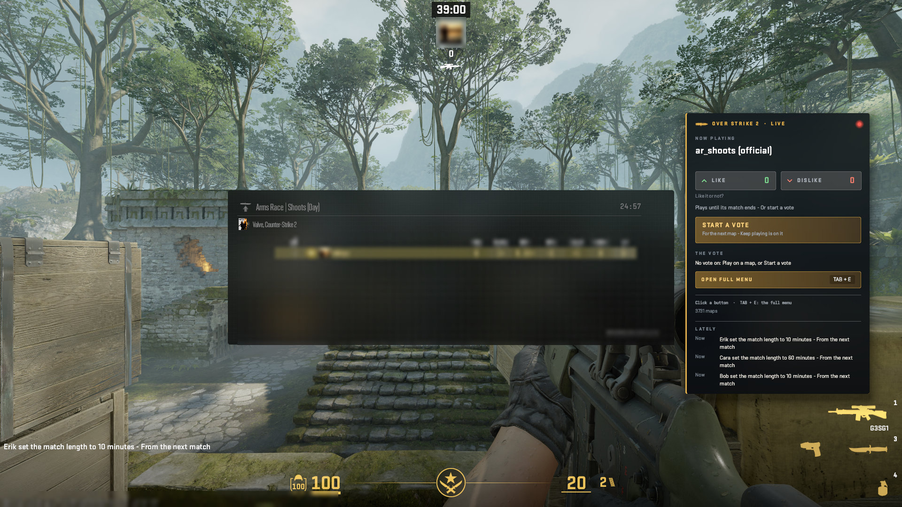
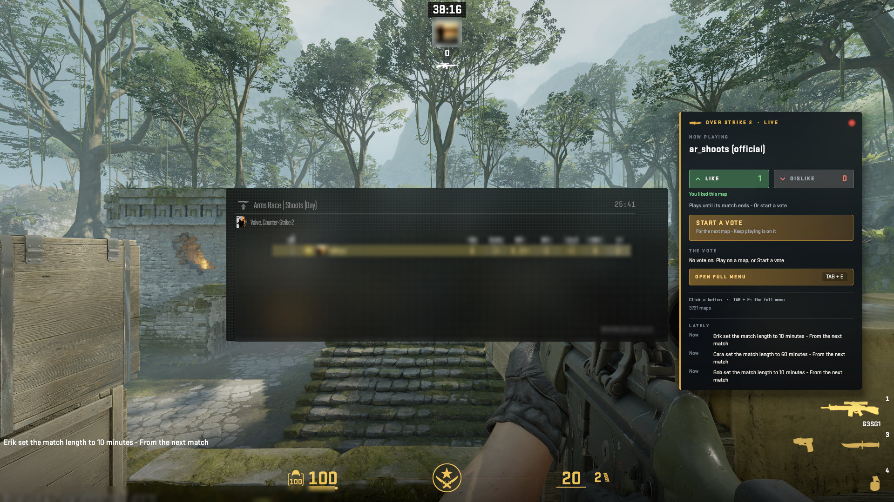
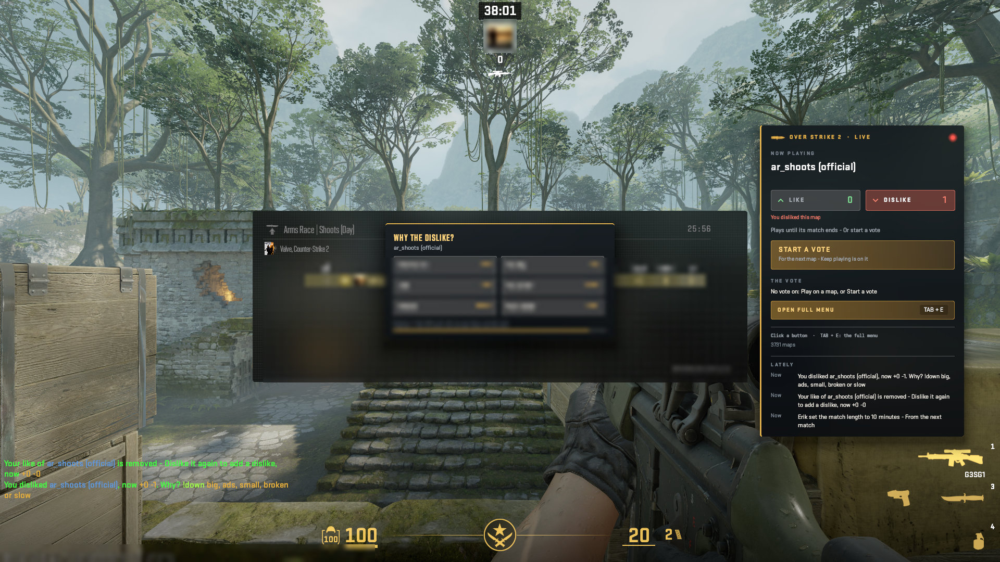
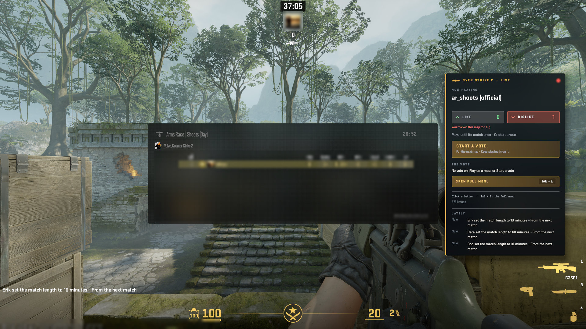
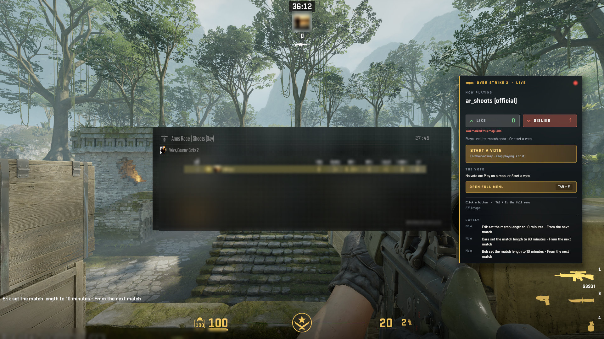
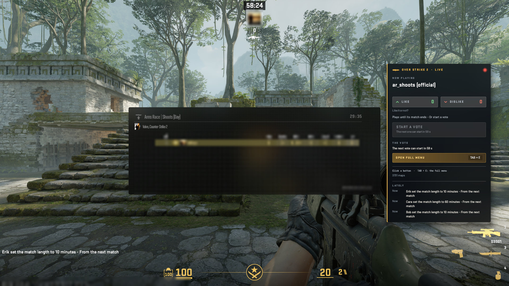

# The HUD: The board

Hold TAB: the board beside CS2's scoreboard - the map that is on, Like and Dislike, Start a vote, the way into the menu, Lately.

A real game client draws every picture here against a test copy of the server, taken by script at 1920x1080, from OverStrike2 40e9206 (HUD content v4.12.2, plugin 5.16.2). Test names only: the avatar is blurred. The index of every part is in the [README](../../README.md#the-hud-page-by-page); every kind of on-screen message is in the [gallery](messages.html).

## The board beside the scoreboard: your like, Start a vote, the vote line, the full menu, Lately

## The board with your like on the map that is on

## Why the dislike? under the TAB cursor

The message: Why the dislike? (the reasons). Where it goes: 7a the window, its own page (Centre-centre (needs an answer)).

## The board with my mark: You marked this map too big (the dislike's reason)

## The board with my mark: You marked this map: ads (the dislike's reason)

## The board in the wait after a vote: Start a vote off, its words say how long

