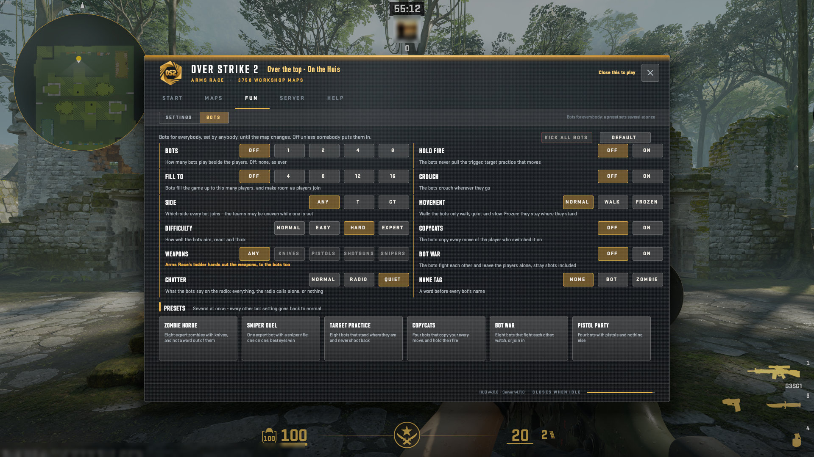
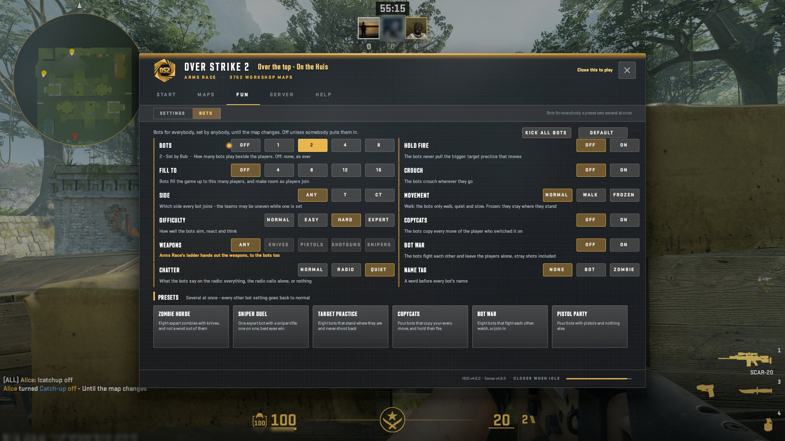
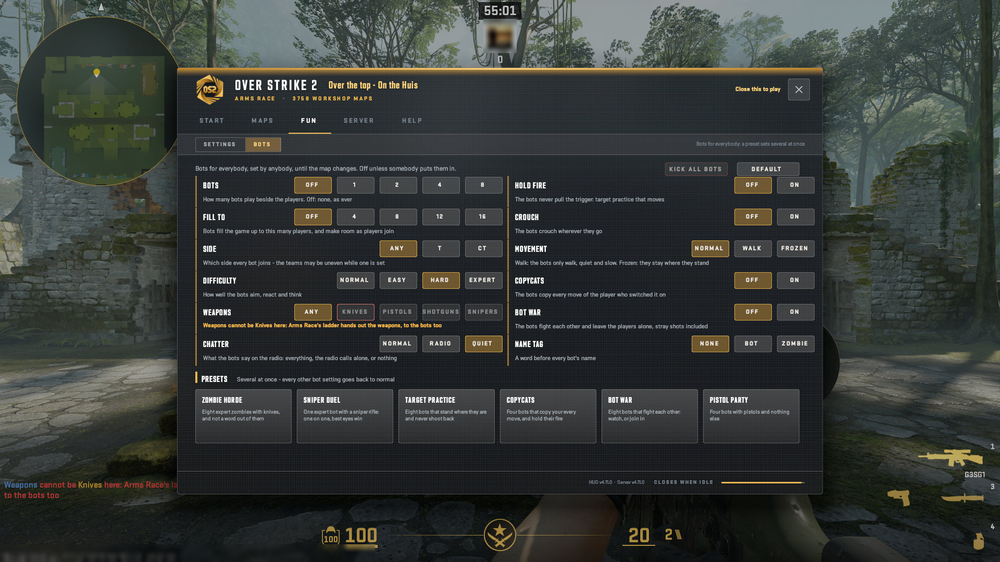
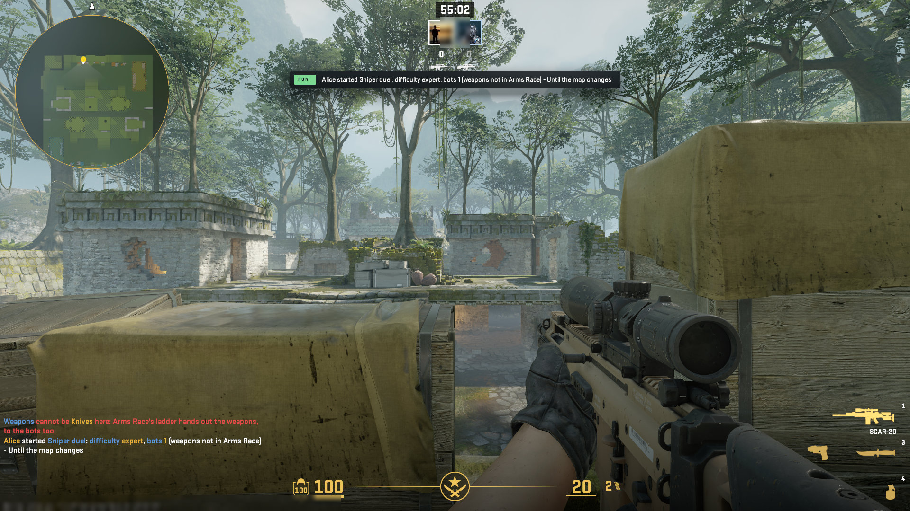
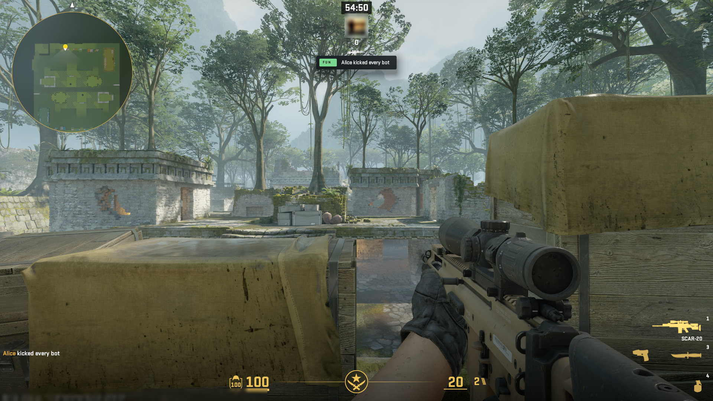
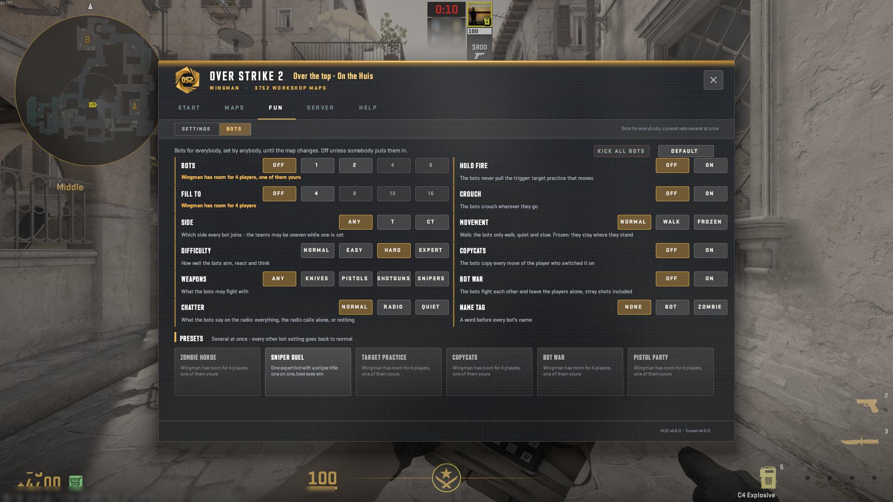

# The HUD: FUN, Bots

Bots for everybody, set by anybody: the twelve rows and six presets at their default, a row set by somebody, a choice Arms Race refuses, Wingman's greying, and the lines everybody gets. Like the fun settings, a row lasts until the map changes - also after the player who set it has left - or until 10 minutes with nobody on.

A real game client draws every picture here against a test copy of the server, taken by script at 1920x1080, from OverStrike2 40e9206 (HUD content v4.12.2, plugin 5.16.2). Test names only: the avatar is blurred. The index of every part is in the [README](../../README.md#the-hud-page-by-page); every kind of on-screen message is in the [gallery](messages.html).

## FUN > Bots: every row at its default, the note, Kick all bots greyed, Default and the six presets

## FUN > Bots: Bots 2 set by Bob, its row marked: 2 - Set by Bob, Kick all bots no longer greyed

## FUN > Bots in Arms Race: Weapons greyed with the ladder's reason, and a click on Knives answered on its row

## The top line: a Bots preset started, who, and what it set

The message: Bots: a preset started, and what it set. Where it goes: 4d top line with a category tab (Top centre); also a line in chat; also listed on the TAB board.

## The top line: Kick all bots, and who

The message: Bots: Kick all bots, or Default. Where it goes: 4d top line with a category tab (Top centre); also a line in chat; also listed on the TAB board.

## FUN > Bots in Wingman: the counts past its room for 4 players greyed, and every preset but Sniper duel

