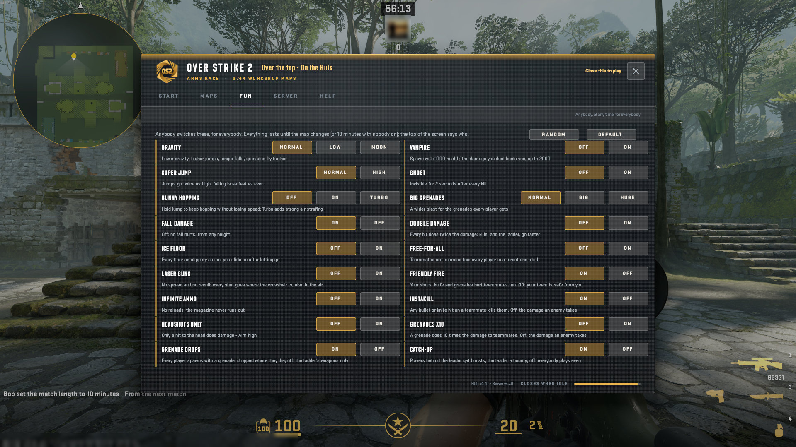
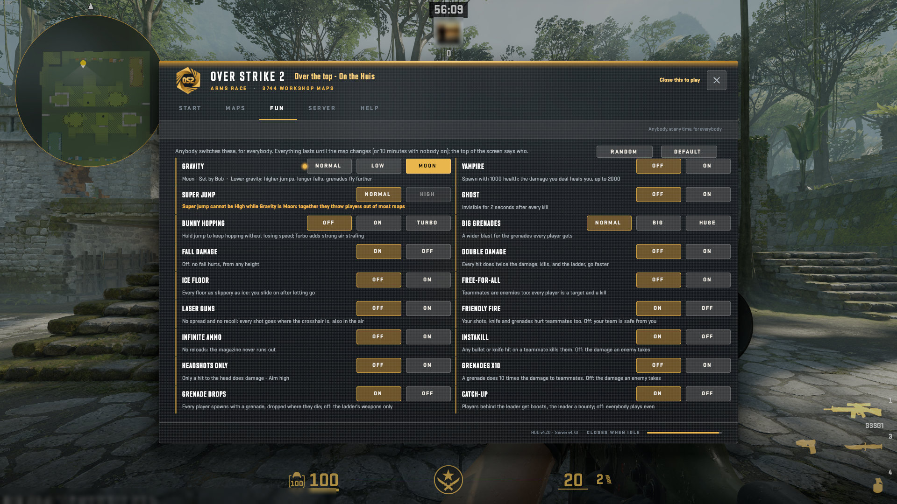
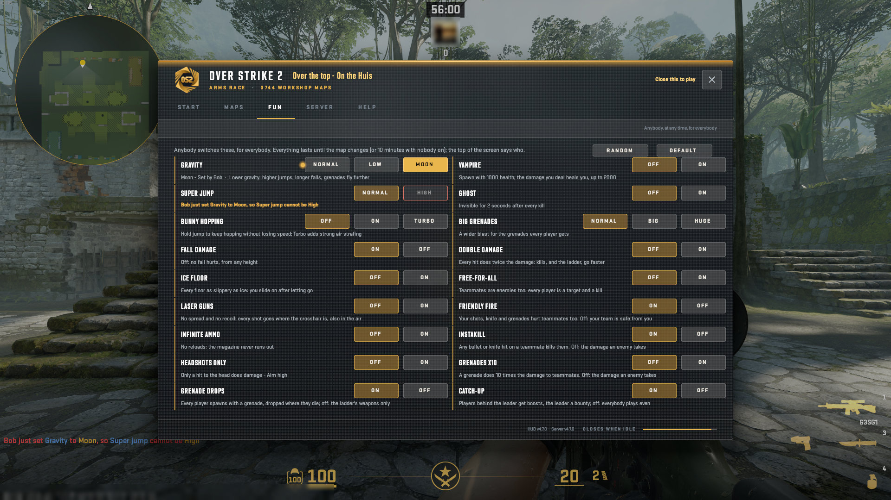
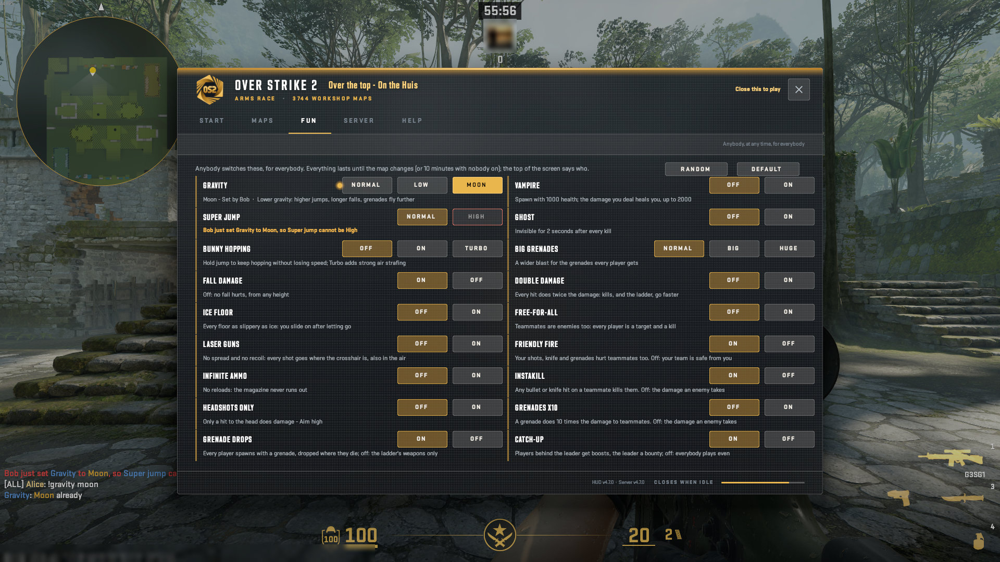
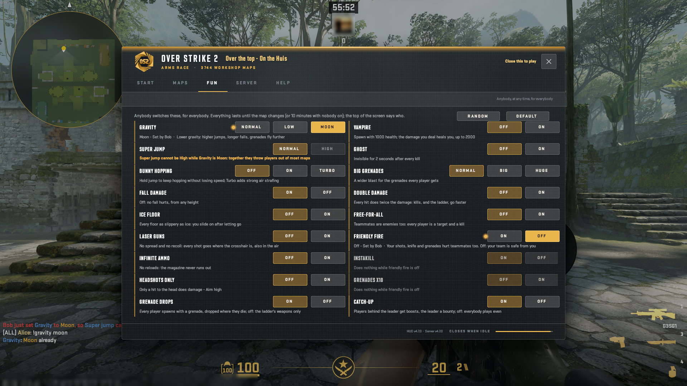
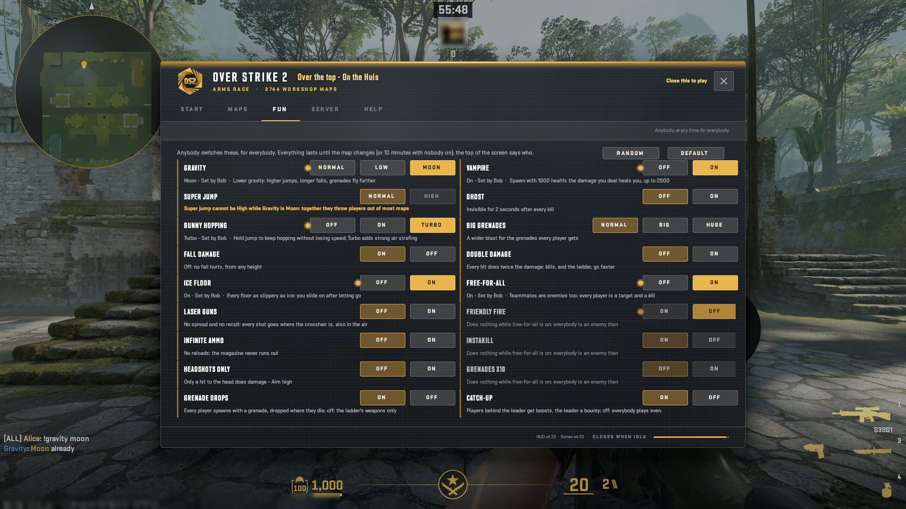
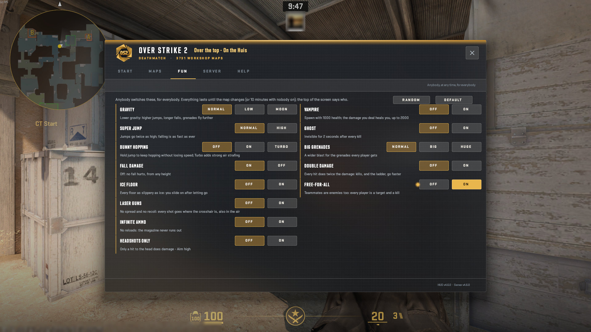
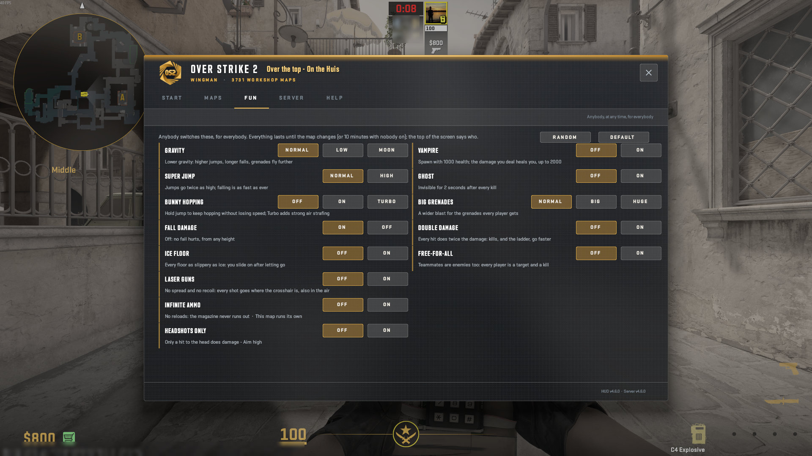

# The HUD: FUN

The fun settings: every one at its default, set by somebody, greyed when impossible, idle in a mode, and the rows of the other modes.

A real game client draws every picture here against a test copy of the server, taken by script at 1920x1080, from OverStrike2 0dee310 (HUD content v4.7.0, plugin 5.1.0). Test names only: the avatar is blurred. The index of every part is in the [README](../../README.md#the-hud-page-by-page); every kind of on-screen message is in the [gallery](messages.html).

## FUN: every setting at its default, the note, Random and Default

## FUN: Gravity Moon, its row marked: Moon - set by Bob

The message: "set by <name>" on settings that are not default. Where it goes: a line on the window's page (Inside the window); also a line in chat; also listed on the TAB board.

## FUN: Super jump High clicked just as Moon gravity greys it: the bubble at the button says why

The message: The answer to your own click: refused, click again, already set. Where it goes: a line on the window's page (Inside the window); also a line in chat; also listed on the TAB board.

## FUN: a greyed choice, and a refused click answered at its button

## Chat: a setting typed that is on already: the reply says so

The message: The answer to your own click: refused, click again, already set. Where it goes: a line on the window's page (Inside the window); also a line in chat; also listed on the TAB board.

## FUN: friendly fire off: Instakill and Grenades x10 dimmed, Does nothing while friendly fire is off

## FUN: several rows off their default, free-for-all idling friendly fire's three

## FUN in Deathmatch: friendly fire's rows, the grenade drops and catch-up gone

## FUN in Wingman

