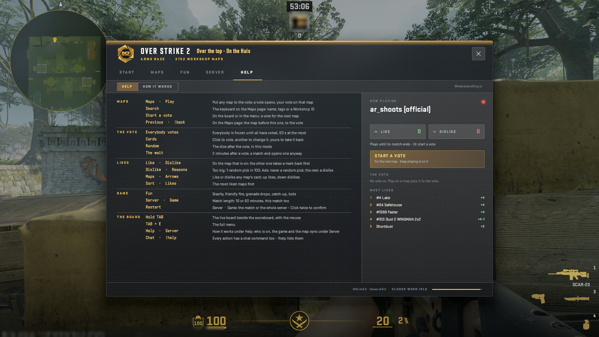

# The HUD: HELP, Help

Where everything is.

A real game client draws every picture here against a test copy of the server, taken by script at 1920x1080, from OverStrike2 868d9ca (HUD content v4.8.0, plugin 5.3.1). Test names only: the avatar is blurred. The index of every part is in the [README](../../README.md#the-hud-page-by-page); every kind of on-screen message is in the [gallery](messages.html).

## HELP > Help: where everything is

