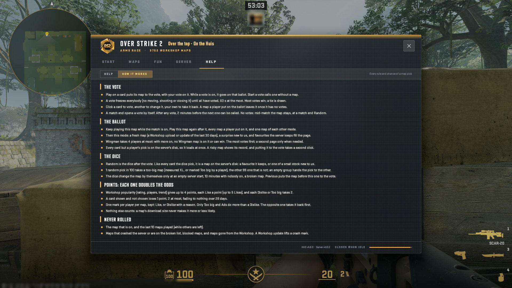

# The HUD: HELP, How it works

Every rule of the vote and every chance of a random pick.

A real game client draws every picture here against a test copy of the server, taken by script at 1920x1080, from OverStrike2 40e9206 (HUD content v4.12.2, plugin 5.16.2). Test names only: the avatar is blurred. The index of every part is in the [README](../../README.md#the-hud-page-by-page); every kind of on-screen message is in the [gallery](messages.html).

## HELP > How it works: every rule and chance of a map pick

