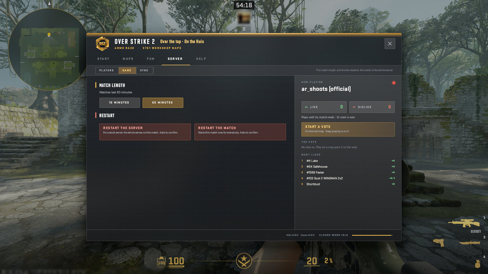
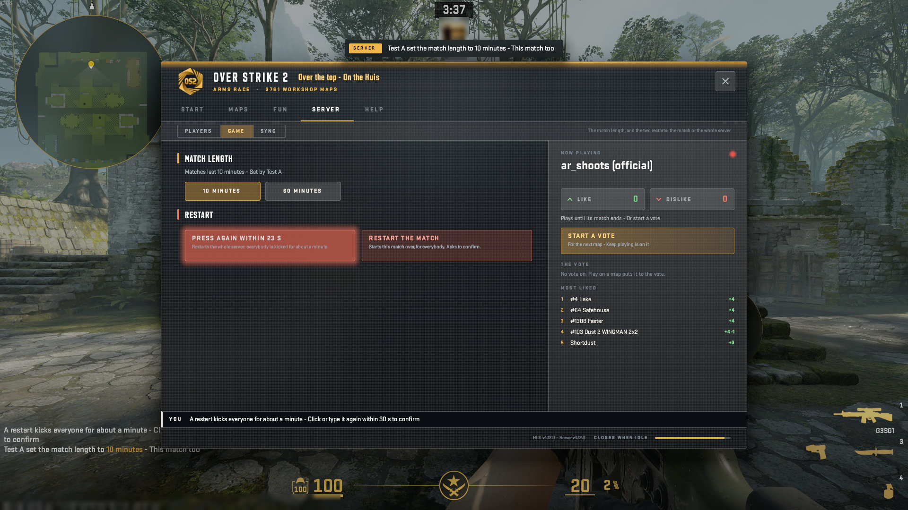
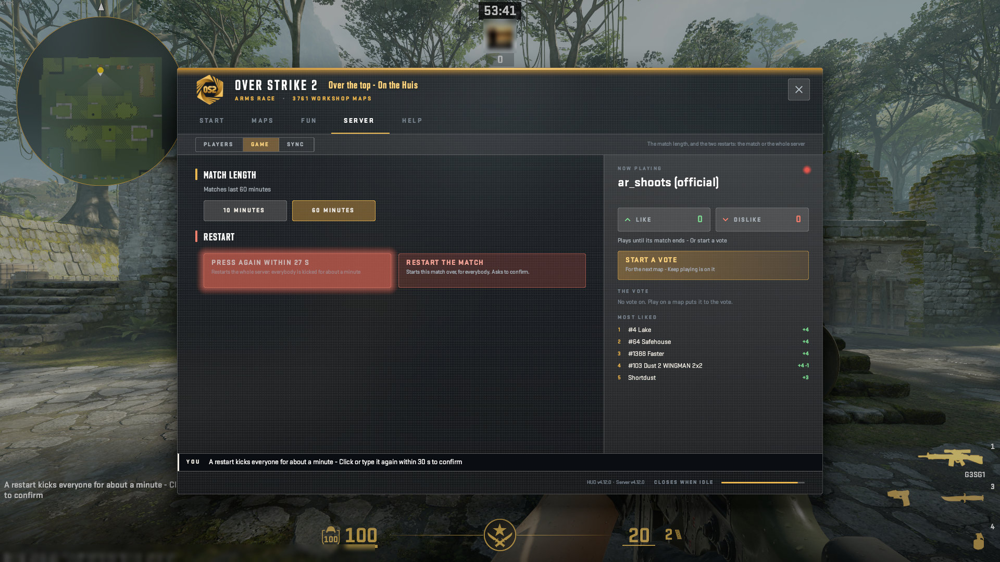
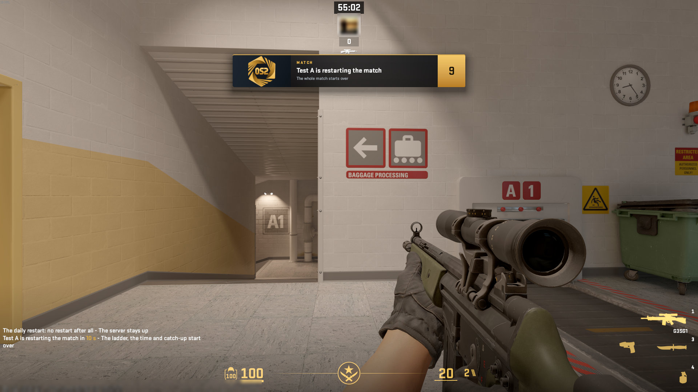
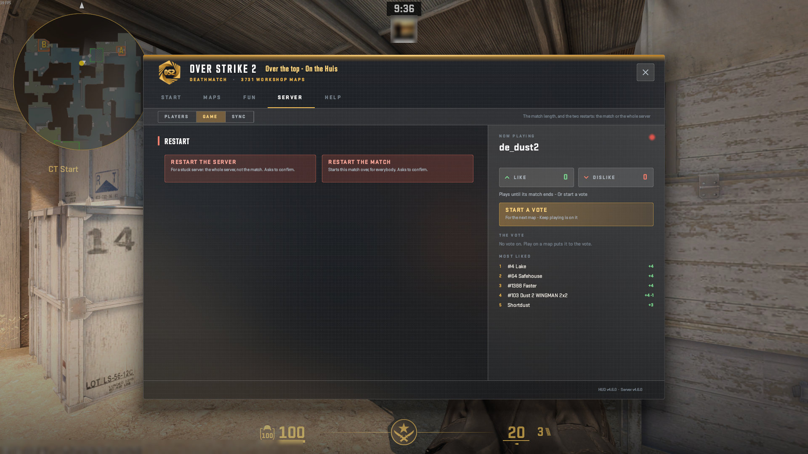
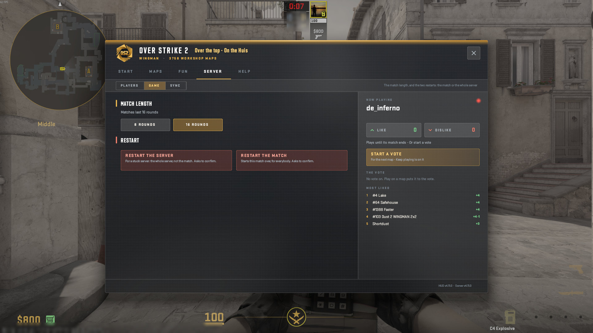

# The HUD: SERVER, Game

The match length, and the two restarts: the match or the whole server.

A real game client draws every picture here against a test copy of the server, taken by script at 1920x1080, from OverStrike2 5f059b9 (HUD content v4.12.0, plugin 5.14.0). Test names only: the avatar is blurred. The index of every part is in the [README](../../README.md#the-hud-page-by-page); every kind of on-screen message is in the [gallery](messages.html).

## SERVER > Game: the match length, the two restarts

## SERVER > Game: Matches last 10 minutes - Set by, the lit button

## SERVER > Game: the restart after its first click, Press again; the line says click again

The message: The answer to your own click: refused, click again, already set. Where it goes: a line on the window's page (Inside the window); also a line in chat; also listed on the TAB board.

## Restart match: the countdown banner, naming who

## SERVER > Game in Deathmatch: its own match length

## SERVER > Game in Wingman

