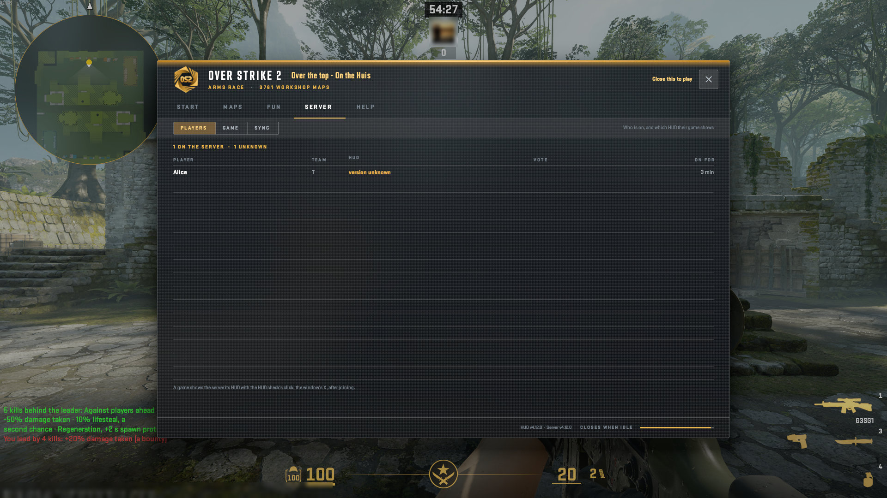
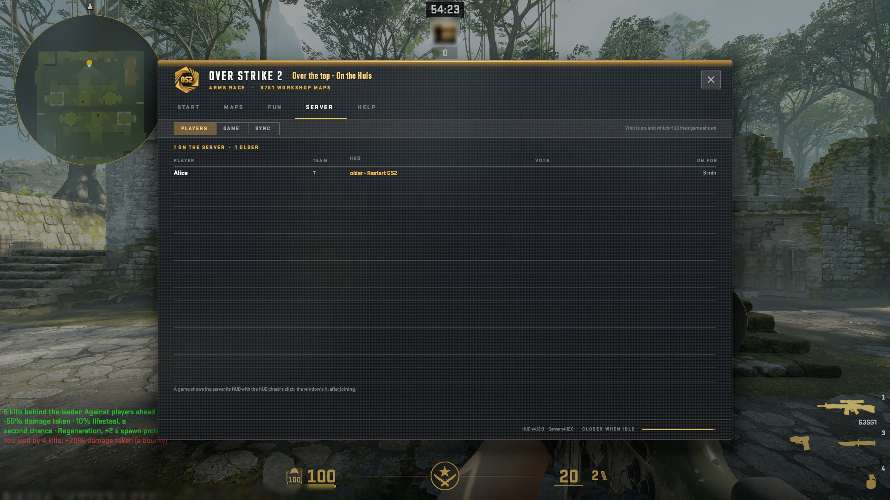
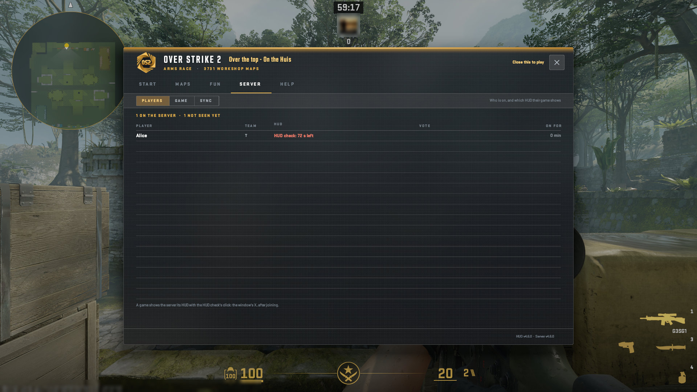
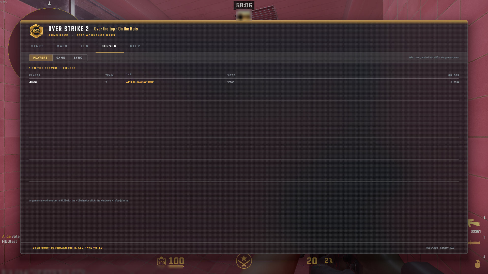

# The HUD: SERVER, Players

Who is on, and which HUD their game shows.

A real game client draws every picture here against a test copy of the server, taken by script at 1920x1080, from OverStrike2 5f059b9 (HUD content v4.12.0, plugin 5.14.0). Test names only: the avatar is blurred. The index of every part is in the [README](../../README.md#the-hud-page-by-page); every kind of on-screen message is in the [gallery](messages.html).

## SERVER > Players: the player, the team, the HUD of the check's click, how long on

## SERVER > Players: an older HUD: older - restart CS2 (os_hud content 1)

## SERVER > Players while the check waits: HUD check: N s left in the HUD column

## SERVER > Players during a vote: who has voted

