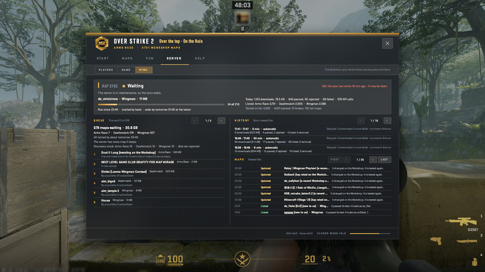
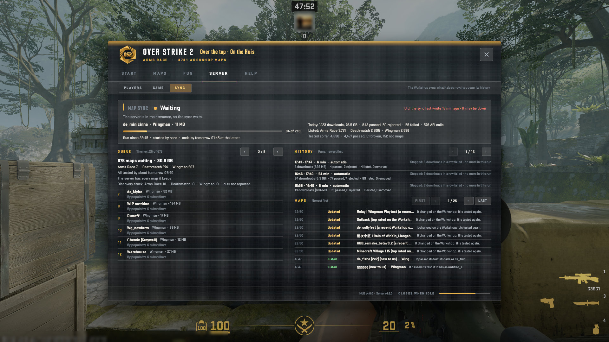
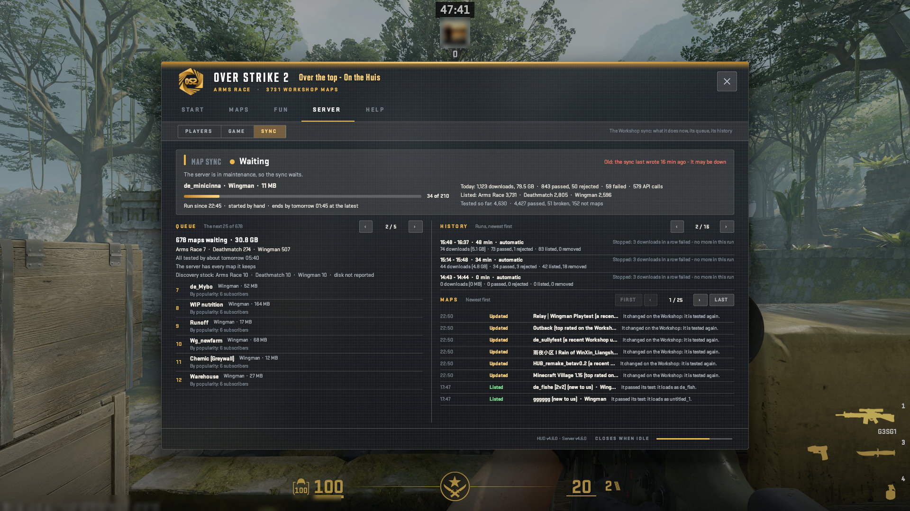
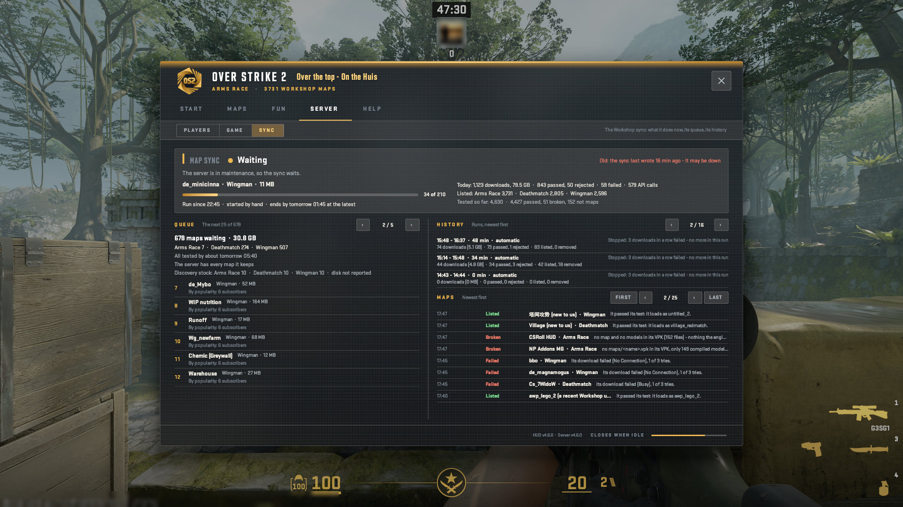
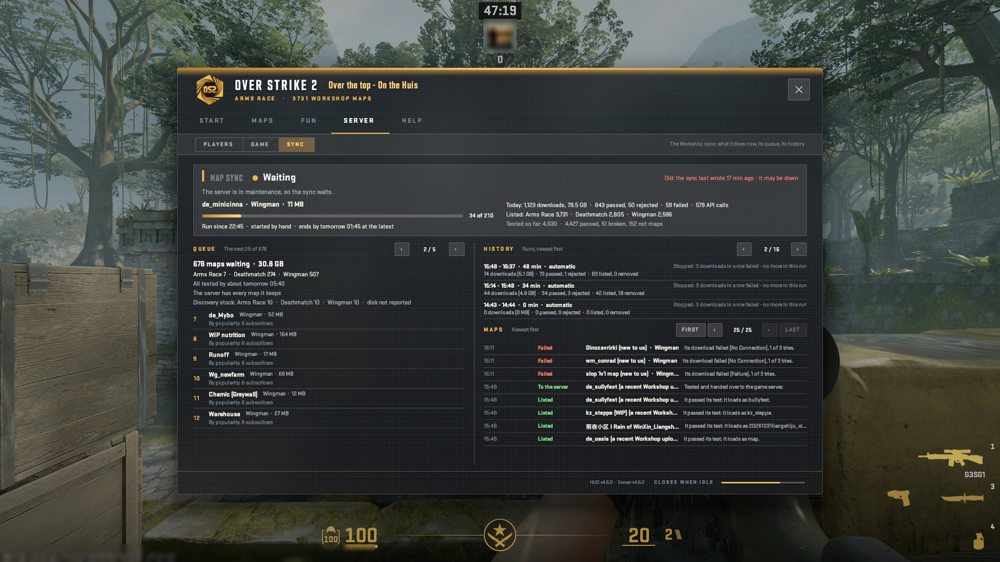

# The HUD: SERVER, Sync

The Workshop sync's dashboard: now, the queue, the history.

A real game client draws every picture here against a test copy of the server, taken by script at 1920x1080, from OverStrike2 e6cb595 (HUD content v4.6.0, plugin 5.0.0). Test names only: the avatar is blurred. The index of every part is in the [README](../../README.md#the-hud-page-by-page); every kind of on-screen message is in the [gallery](messages.html).

## SERVER > Sync: what the map sync does, its queue, its history

## SERVER > Sync: the queue's next page

## SERVER > Sync: the history's next page

## SERVER > Sync: the map events' next page

## SERVER > Sync: the map events' last page

