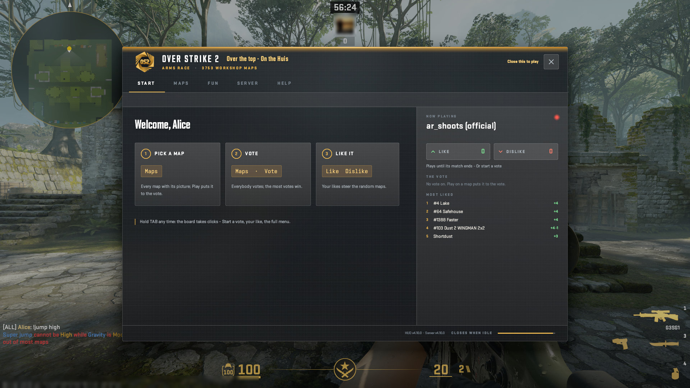
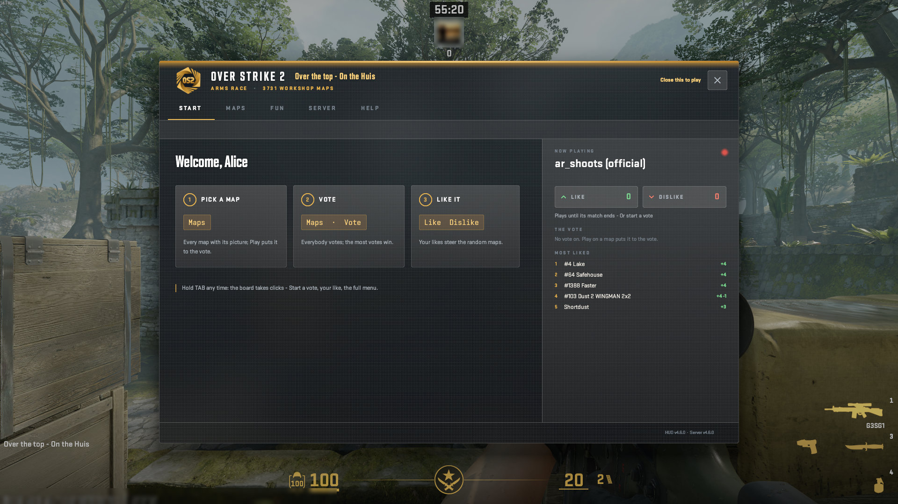
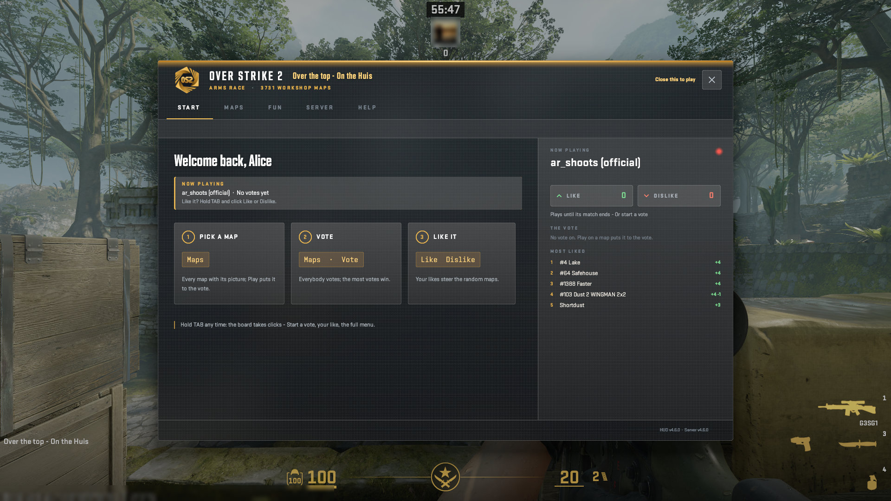
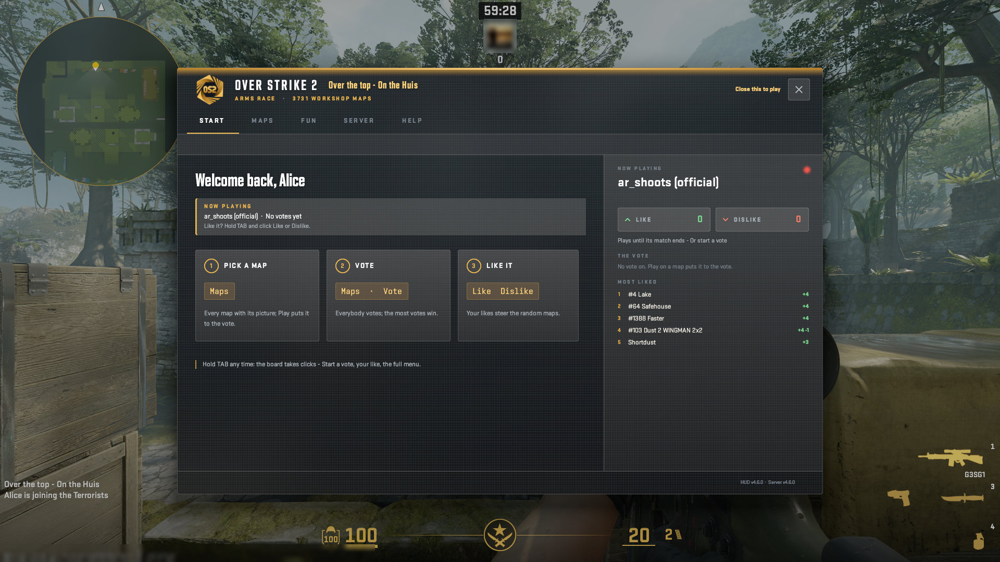
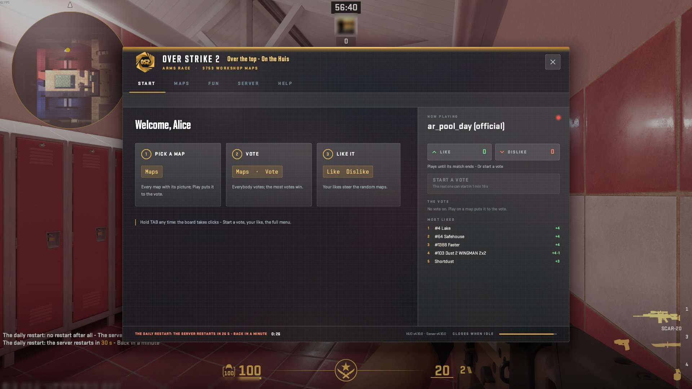
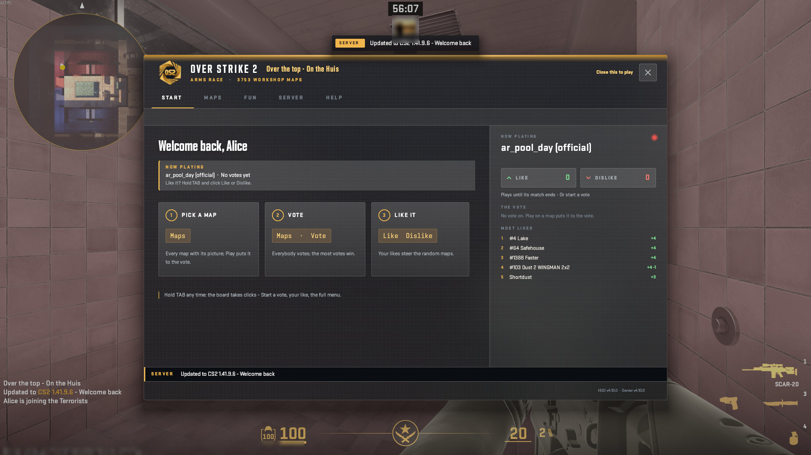
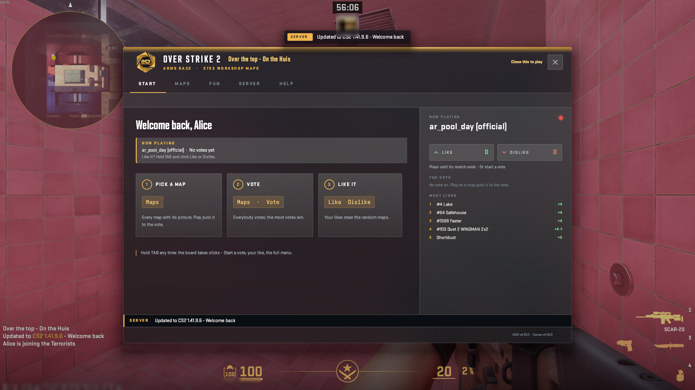
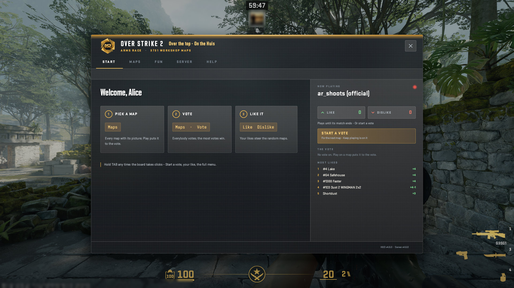

# The HUD: START

The window's first page, and the welcome at a join.

A real game client draws every picture here against a test copy of the server, taken by script at 1920x1080, from OverStrike2 5d37792 (HUD content v4.10.0, plugin 5.6.1). Test names only: the avatar is blurred. The index of every part is in the [README](../../README.md#the-hud-page-by-page); every kind of on-screen message is in the [gallery](messages.html).

## START: the logo and the large text, the steps, the live column, the gold Start a vote

## The welcome window at a first login: until its X

The message: Welcome window, at every login. Where it goes: 7a the window, its own page (Centre-centre (needs an answer)).

## The welcome window at a return: Welcome back, the map that is on, its likes, the hint

The message: Welcome-back card. Where it goes: a line on the window's page (Inside the window).

## The welcome window at a return: the tagline's line at the foot of its page, for 3 s

The message: Join tagline. Where it goes: a line on the window's page (Inside the window); also a line in chat.

## The welcome window at a real join, while the HUD check waits: the X is the version button, Close this to play beside it

The message: HUD check: Click to play. Where it goes: 7a the window, its own page (Centre-centre (needs an answer)).

## The top line above the open window: one line, 84 px from the top

## The window's foot: a restart coming, its words and its countdown

## The line for a player who joins within 10 minutes of an update (the catalogue's UpdatedJoiner; no row of its own in the picks)

## START, back on Arms Race: the run's last frame

